

# מסמכים: המסך הראשי והצעות למסכים הפנימיים

**מצב:**
- המסך הראשי ממומש ב־[#916](https://github.com/eldad8802-prog/business-platform/pull/916) (Draft, לא מוזג). הצילומים מ־HEAD ‏`dea9edde`.
- המסכים הפנימיים הם **הצעות בלבד**. הם לא מאושרים ולא ממומשים.

**מקור הצילומים:**
- צילומי המסך הראשי נלקחו מהמסך הממומש, בשרת פיתוח מקומי עם API מדומה. לא נגענו בשום עסק, והמספרים הם נתוני בדיקה.
- ההצעות הן הדמיות סטטיות באותה שפה חזותית.

**נדרש לפני סגירה:** בדיקת Preview מחוברת בעסק 9, וצילום והעלאה אמיתיים בטלפון.

---

## 1. המסך הראשי הממומש (#916)

### מובייל, 390px

**נתונים, ראש המסך.** ״חזרה״, כותרת ״מסמכים״ (Heebo 800, רק במסך הזה), סיכום חודשי, ושתי הפעולות הראשונות.

**נתונים, תחתית המסך.** ״לאמת מסמכים״ עם מספר הממתינים מכל החודשים, ״למצוא מסמך״, Gmail, ‏WhatsApp (״בקרוב״, ללא שינוי) וחבילת רו״ח.

**אין נתונים.** ₪0 והודעה ״אין עדיין הכנסות או הוצאות רשומות לחודש הזה״. האריח מציג ״אין מסמכים ממתינים״.

**טעינה.** הסכומים מהבהבים, והפעולות זמינות מיד.

**שגיאת טעינה.** הודעה עם ״נסה שוב״. הפעולות נשארות זמינות.

**העלאה בתהליך.** ״מעלה…״. העלאה וצילום מושבתים עד הסיום.

 

**מסך צר, 360px.** בלי גלילה אופקית.

 

### דסקטופ, 1440px

**נתונים.** ארבע פעולות בשורה; Gmail/WhatsApp וחבילת רו״ח זה לצד זה; טבלת מסמכי החודש הקיימת נשמרה מתחת.

**אין נתונים · טעינה · שגיאה**

### סטיות מההדמיה המאושרת

| # | בהדמיה | במימוש | סיבה |
|---|---|---|---|
| 1 | ״נתונים להמחשה״ | ״נטו החודש״, ושינוי מהחודש הקודם רק כשיש השוואה אמיתית | לא מציגים ״להמחשה״; משמעות הסיכום נשמרת |
| 2 | כותרת כבדה מאוד | Heebo 800 שנטען רק במסך הזה | שאר האפליקציה נשארת 300–600 |
| 3 | חץ ״›״ מימין ל־Gmail | חץ ״‹״ משמאל | ניווט RTL קיים: חץ ״קדימה״ פונה שמאלה |
| 4 | לוגו Gmail אדום | הלוגו הרשמי שקיים באפליקציה | לא משנים סימני מותג |
| 5 | ״3 ממתינים לאישור״ | המספר האמיתי מכל החודשים (`needs_review`) | לפי הדרישה, מנתון שכבר קיים ב־API |
| 6 | תת־כותרת WhatsApp בשורה אחת | שתי שורות ב־390px ומטה | הטקסט המלא נשמר |
| 7 | סרגל תחתון בעיצוב ההדמיה | הסרגל הקיים של האפליקציה | משותף לכל האפליקציה |
| 8 | אין | ״קובץ עד 4MB · PDF או תמונה״ | המגבלה האמיתית במסלול הזה |
| 9 | מובייל בלבד | התאמה ל־768, ‏1024 ו־1200px, כולל טבלת הדסקטופ הקיימת | לא מאבדים יכולת קיימת |
| 10 | שקלים שלמים | שקלים שלמים בסכומים הגדולים; הנטו עם אגורות | כמו בהדמיה |

---

## 2. הצעה · איתור ועיון בכל המסמכים

**1א · כניסה מ״לאמת מסמכים״.** נפתח תמיד מסונן ל״ממתינים לאימות״, מכל החודשים, הישן קודם.

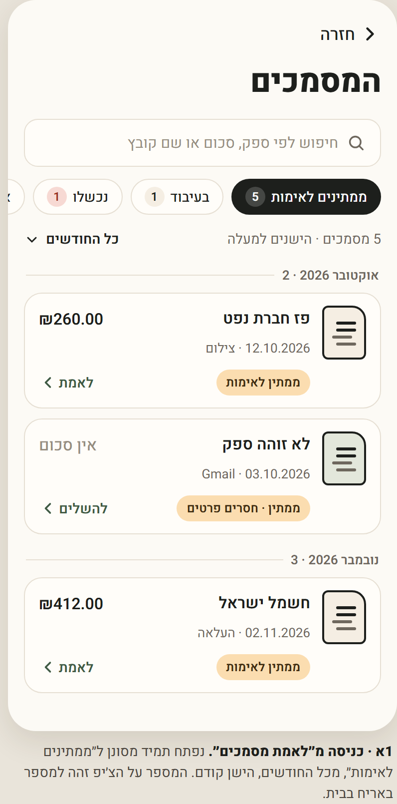

**1ב · כניסה מ״למצוא מסמך״.** חיפוש בכל המסמכים, לשונית ״הכל״ ומיקוד בשדה. רשומה כספית מאושרת מוצגת בנפרד ממסמך שעוד לא נרשם.

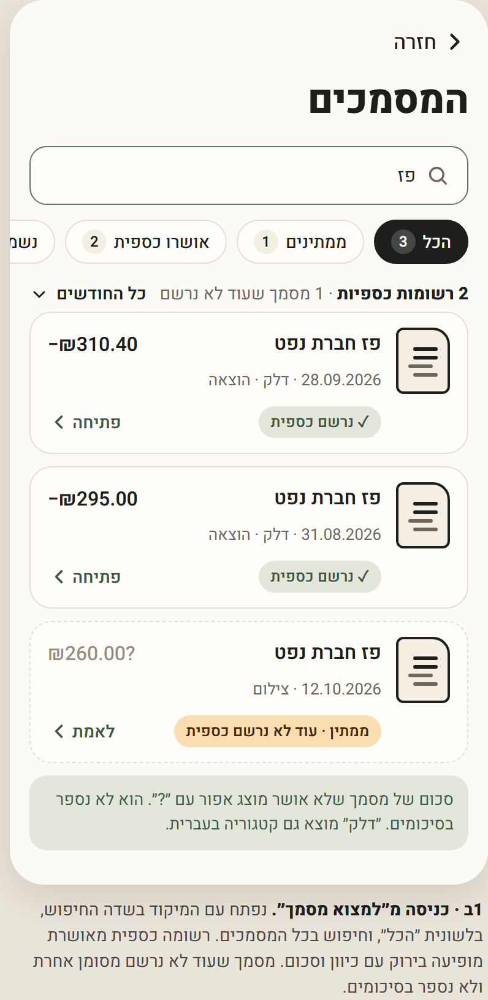

**1ג · נכשלו ובעיבוד.** לכל מצב יש לשונית ופעולה, כך שאף מסמך לא נעלם.

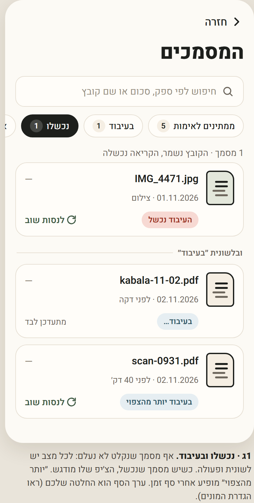

**1ד · מסמכי מידע ומצב ריק.**

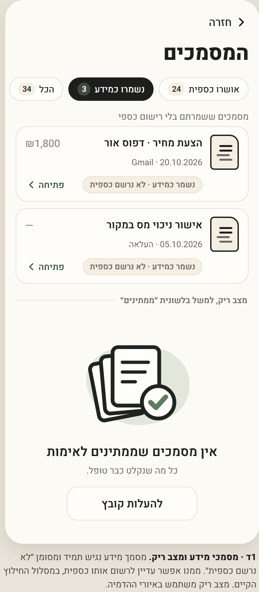

**1ו · מסנן תאריך מפורש.** בחירה בין ״תאריך המסמך״ ל״תאריך ההעלאה״. מסמך שתאריכו לא זוהה מופיע בקבוצה ובתווית משלו.

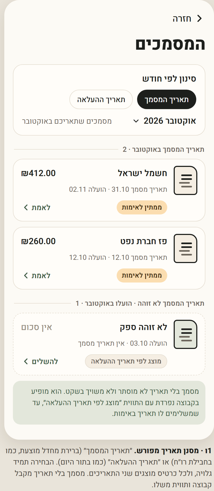

**1ה · דסקטופ.** טבלה ופאנל פרטים. כל הפעולות של הטבלה הקיימת נשמרות: בחירה בלחיצה או במקלדת, פאנל פרטים, ו״פתח לאימות״.

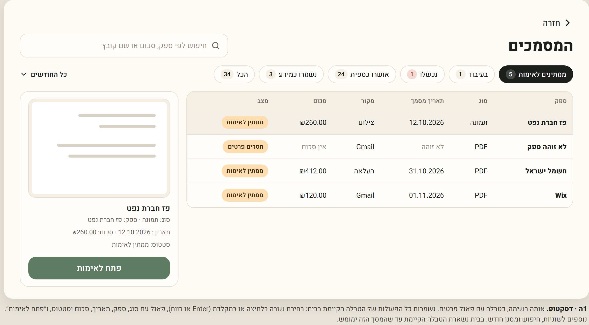

## 3. הצעה · צפייה במסמך ואימותו (מתואם עם #917–#919)

**2א · צפייה ואימות.** המקור, עם מסך מלא והורדה; מה שזוהה; ופעולות קבועות בתחתית.

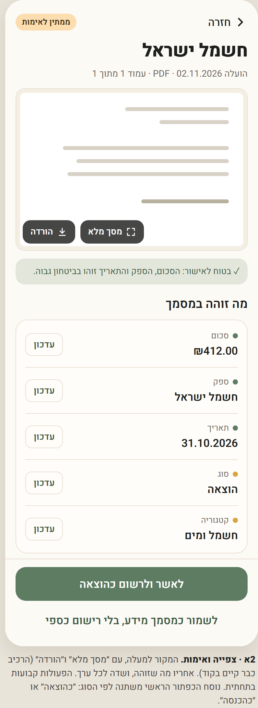

**2ב · עריכת שדה עם ביטול אמיתי.**

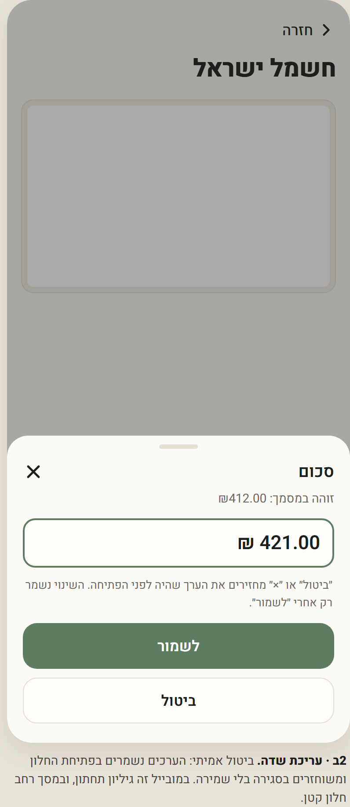

**2ג · המקור במסך מלא.** מבוסס על הרכיב הקיים.

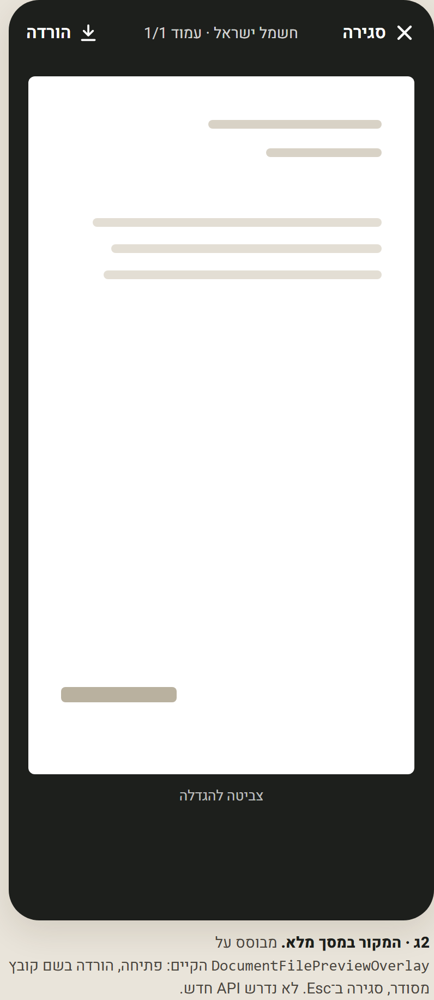

**2ד · אחרי אישור.** ״למסמך הבא״ מכל החודשים.

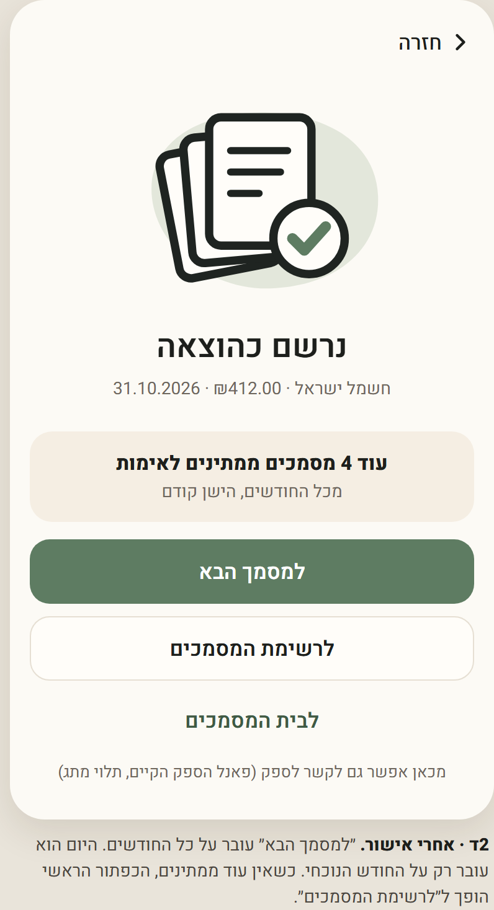

**2ה · בעיבוד ונכשל.**

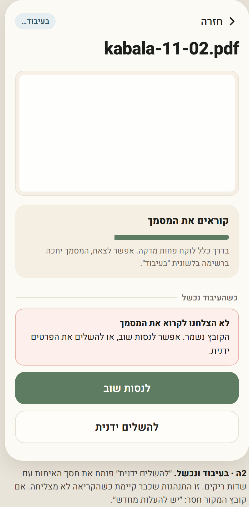

**2ו · ״לא נמצא״ מול ״לא נטען״.**

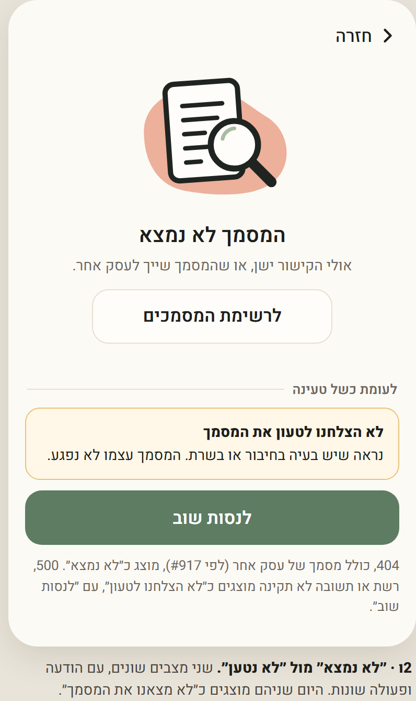

**2ז · מקום לשאלת ״דוח Z או סליקה״ של #917.** הנוסח והלוגיקה של #917 לא משתנים.

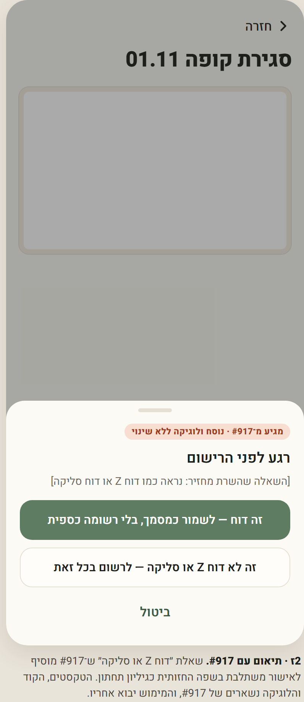

## 4. הצעה · העלאה ובחירה ידנית מ־Gmail

**3א · העלאה.** גיליון אחד לכל נקודות הכניסה.

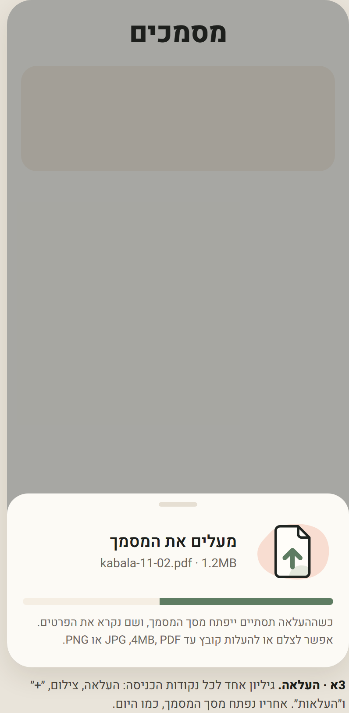

**3ב · קובץ שנדחה.** הודעה ברורה ודרך להמשיך.

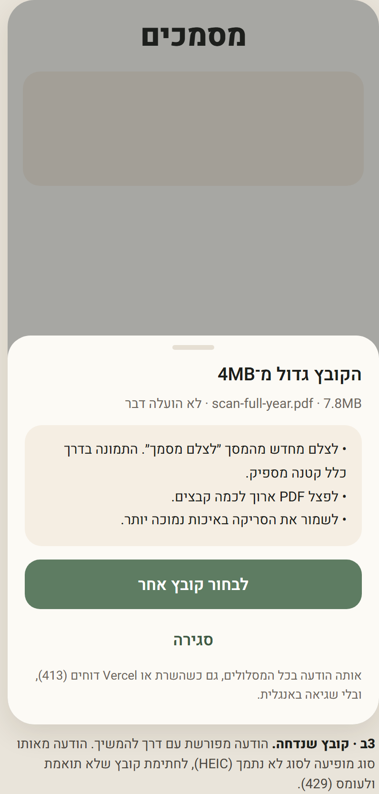

**3ג · כפילות.** מוצגת חלופה. ההחלטה טרם התקבלה.

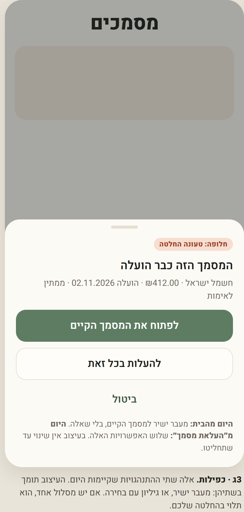

**3ד · Gmail, בחירה ידנית.** כולל תצוגה מקדימה.

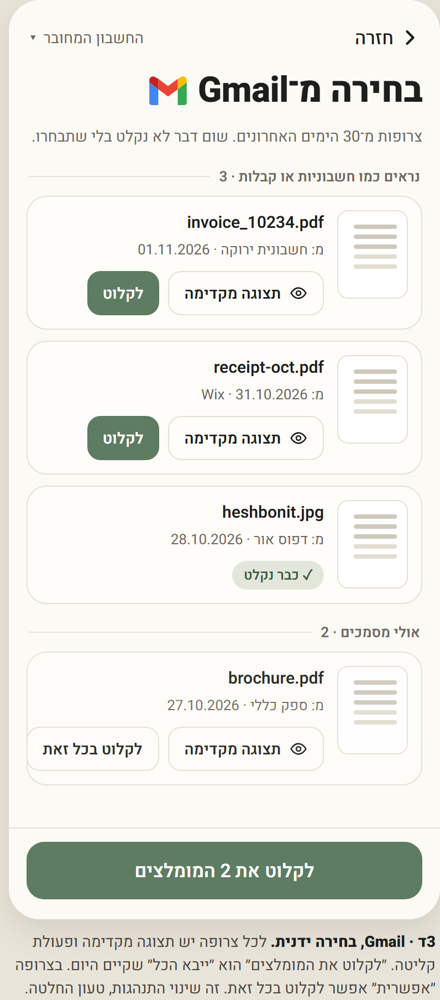

**3ה · תצוגה מקדימה לפני קליטה.**

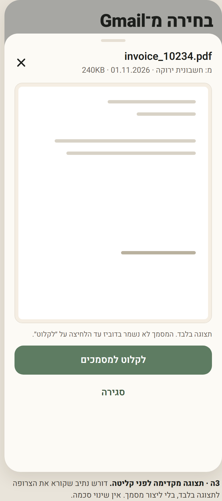

**3ו · אחרי קליטה.** קישור ישיר לכל מסמך שנוצר.

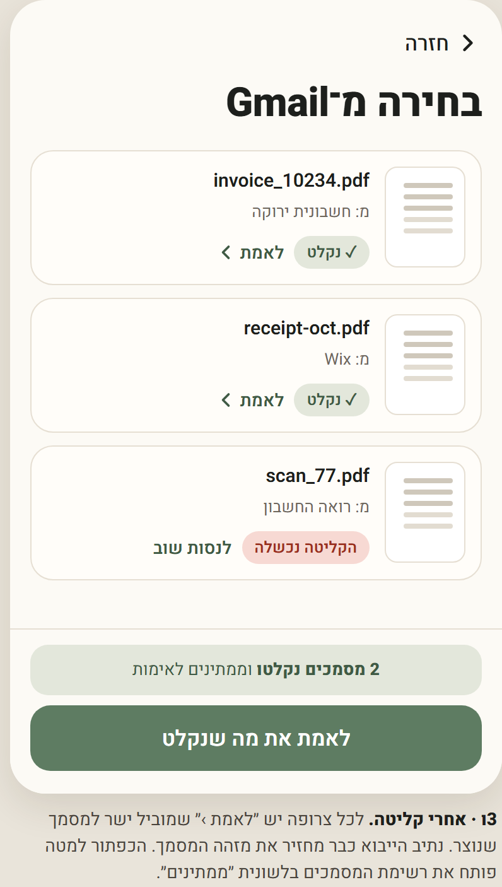

## 5. הצעה · חבילת רו״ח

**4א · ״בתקופה שנבחרה״ מול ״בכל החודשים״.** שלושה מונים נפרדים: ממתינים לאימות, בעיבוד, נכשלו.

**4ב · חבילה מוכנה.**

**4ג · דוחות וייצוא.** כניסה לשני מסכים קיימים שאין אליהם היום קישור: ״הכנסות והוצאות״ ו״מבנה אחיד״.

