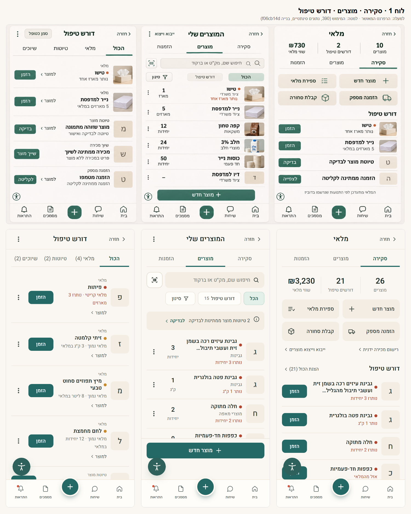
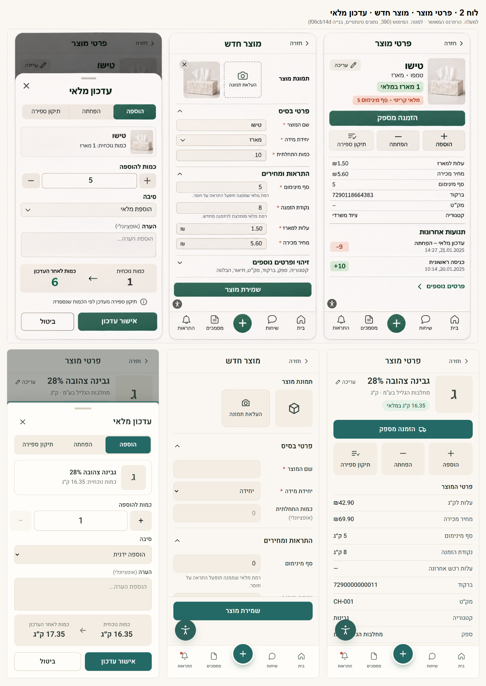
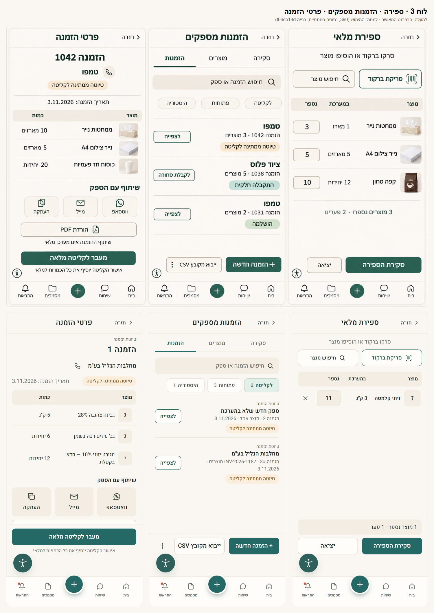
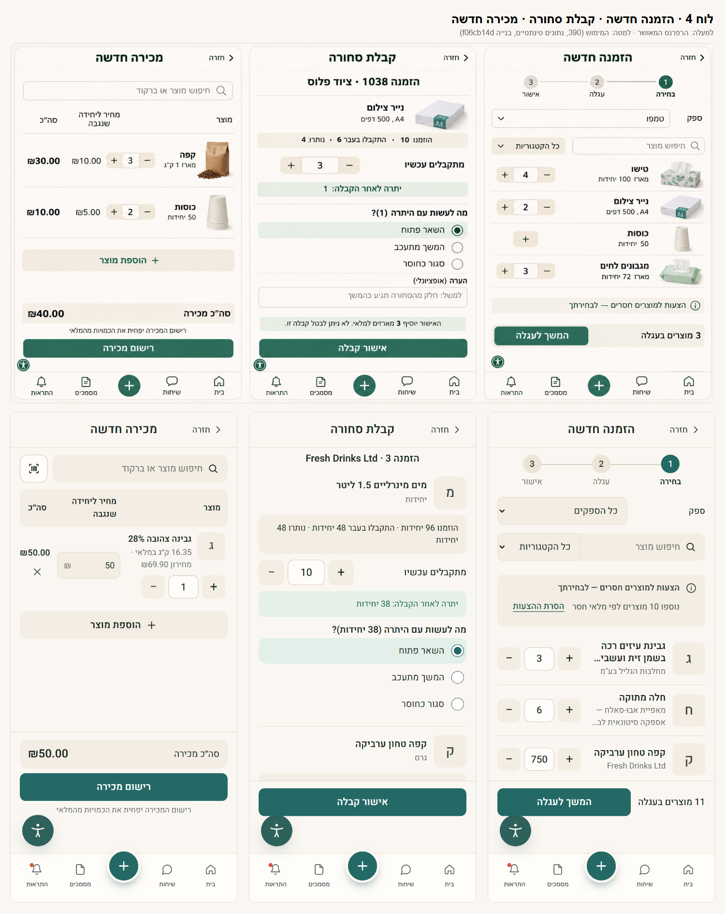
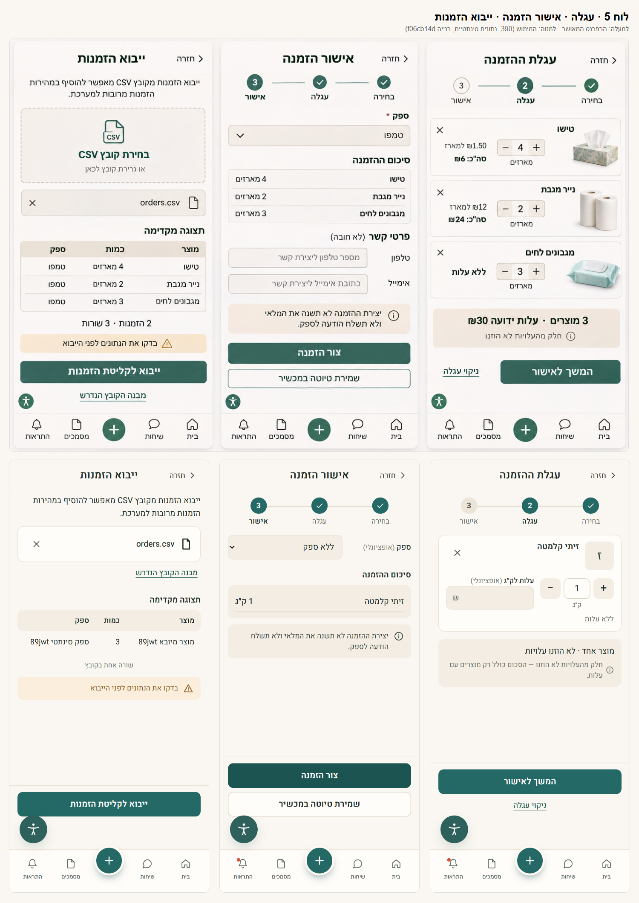
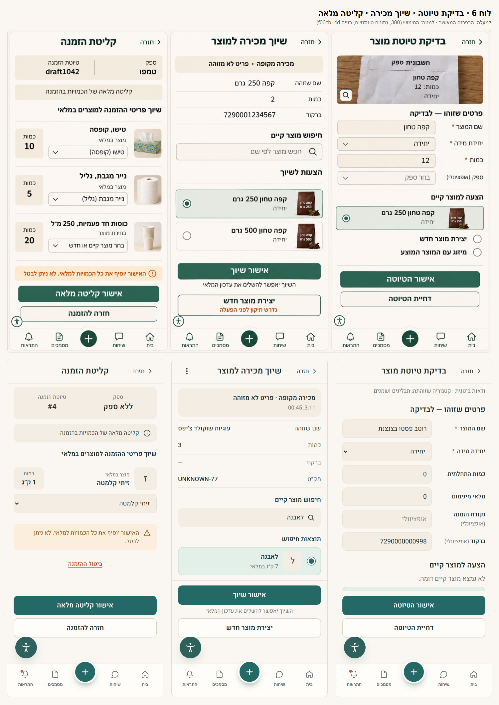

# עיצוב המלאי — גלריית ביקורת חזותית

הגלריה הזו מיועדת לבדיקת עיצוב המלאי לפני מיזוג. היא נפתחת ישירות ב־GitHub, או מקומית מתוך קובץ ה־zip, בלי Claude.

- **מקור:** בנייה מלאה של `f06cb14d`. זה התוכן של #929–#932 על בסיס #926 ו־#927, ואותו עץ שה־CI בדק ב־#933.
- **סביבה:** Postgres מקומי ונתונים סינתטיים בלבד. בלי Production, ובדפדפן נחסמה כל כתובת שאינה מקומית.
- **רוחבים:** 390 (iPhone), 360, 768 (טאבלט) ו־1440 (דסקטופ).
- **מה לא בגלריה:** התמונות וערכי הדוגמה מההדמיות לא שימשו כנתונים. מוצר בלי תמונה מוצג עם אות או סמל.

## 1. השוואה ל־18 המסכים המאושרים

בכל תמונה הלוח המאושר מופיע למעלה, ושלושת המסכים שמומשו מתחתיו.

| | |
|---|---|
|  |  |
| **1** · סקירה · מוצרים · דורש טיפול | **2** · פרטי מוצר · מוצר חדש · עדכון מלאי |
|  |  |
| **3** · ספירה · הזמנות מספקים · פרטי הזמנה | **4** · הזמנה חדשה · קבלת סחורה · מכירה חדשה |
|  |  |
| **5** · עגלה · אישור הזמנה · ייבוא הזמנות | **6** · בדיקת טיוטה · שיוך מכירה · קליטה מלאה |

הלוחות המקוריים נמצאים בתיקייה `reference/`.

## 2. מפת כיסוי: כל המסכים והחלוניות

שמות הקבצים זהים בכל תיקיות הרוחב: `screens/mobile-390/`, `screens/mobile-360/`, `screens/tablet-768/`, `screens/desktop-1440/`. ב־390 יש גם גרסת עמוד מלא בשם `*--full.png`.

| מסך או חלונית | כתובת | לוח | קבצים |
|---|---|---|---|
| סקירה | `/inventory` | 1 | `overview` |
| המוצרים שלי | `/inventory/items` | 1 | `items`, `items-low`, `items-missing`, `items-noresult`, `items-large` (136 מוצרים) |
| דורש טיפול | `/inventory/alerts` | 1 | `alerts` |
| פרטי מוצר | `/inventory/items/[id]` | 2 | `item`, `item-long`, `item-404` |
| חלונית עדכון מלאי | `?move=IN` / `ADJUSTMENT` | 2 | `item-move`, `item-move-adj`; ובזרימות: `move-in-filled`, `move-out-error` |
| מוצר חדש | `/inventory/items/create` | 2 | `item-create`; ובזרימות: `create-invalid`, `create-after` |
| עריכת מוצר (מסך חדש) | `/inventory/items/[id]/edit` | — | `item-edit`; ובזרימות: `edit-filled` |
| ספירת מלאי | `/inventory/count` | 3 | `count`; ובזרימות: `count-search`, `count-list`, `count-review` |
| הזמנות מספקים | `/inventory/supplier-purchases` | 3 | `orders` |
| היסטוריה (הפניה) | `/supplier-purchases/history` ← `?tab=history` | — | `history-redirect` |
| פרטי טיוטת הזמנה | `/supplier-purchases/[id]/send` | 3 | `order-send-pending`, `order-send`; ובזרימות: `send-after-share` |
| פרטי הזמנת רכש (חדש) | `/supplier-purchases/orders/[poId]` | — | `order-po`, `order-po-partial` |
| הזמנה חדשה · עגלה · אישור | `/new`, `/new/cart`, `/new/confirm` | 4, 5 | `order-new`, `order-cart`, `order-confirm`; ובזרימות: `wizard-1`, `wizard-cart`, `wizard-confirm`, `wizard-after` |
| קבלת סחורה | `/supplier-purchases/[poId]/receive` | 4 | `receive-partial`; ובזרימות: `receive-filled` |
| קליטה מלאה | `/supplier-purchases/pending` | 6 | `pending`, `pending-draft`; ובזרימות: `pending-detail` |
| ייבוא הזמנות | `/supplier-purchases/import` | 5 | `import`; ובזרימות: `import-preview`, `import-result` |
| אינטגרציות | `/supplier-purchases/integrations` | — | `integrations` |
| מכירות | `/inventory/sales` | — | `sales` |
| מכירה חדשה | `/inventory/sales/create` | 4 | `sale-new`; ובזרימות: `sale-filled` |
| טיוטות מוצר ובדיקה | `/inventory/drafts` | 6 | `drafts`, `draft-review`; ובזרימות: `drafts-after` |
| שיוך מכירה | `/inventory/unmatched` | 6 | `unmatched`, `unmatched-detail`; ובזרימות: `unmatched-selected` |

`flows/` מכיל צילומים מתוך פעולות אמיתיות שבוצעו דרך הממשק. כל פעולה אומתה במסד הנתונים המקומי.

## 3. מצבים

- **ריק** (עסק בלי נתונים): `states/empty-m390-*` — סקירה, מוצרים, דורש טיפול, ספירה, הזמנות, הזמנה חדשה, מכירות, טיוטות, שיוך.
- **שגיאת שרת עם ניסיון חוזר**: `states/error-m390-*` — 8 מסכים. בכולם ההודעה בעברית, בלי טקסט שרת גולמי.
- **שם ארוך**: `screens/*/item-long.png`, ובשורה הראשונה של `items.png`.
- **תמונה חסרה**: כל המוצרים בסביבה המקומית מוצגים עם אות, ומוצר בלי שם מוצג עם סמל (`item-create`). הסביבה המקומית לא מגישה תמונות, ולכן כל כתובת תמונה נכשלת ומוצג התחליף. הצגה של תמונה אמיתית לא נבדקה, ראו בהמשך.
- **אימות שדות**: `flows/create-invalid.png`.
- **חיפוש ללא תוצאות**: `items-noresult`.
- **רשימה גדולה**: `items-large`, עם "הצגת עוד" אחרי 50 שורות.
- **חלונות אישור**: `flows/count-review.png`, וב־`wizard-confirm` לפני "צור הזמנה".

## 4. חריגות מהרפרנס שנותרו, והסיבה

| מסך | בלוח | במימוש | סיבה |
|---|---|---|---|
| כל המסכים | תמונות ונתוני דוגמה | תמונות העסק, או אות כשאין | ההדמיה אינה נתוני עסק |
| דורש טיפול | "סמן כטופל" בכותרת | ⋮ ← "סימון כטופל" בכל שורת מלאי | לכפתור יחיד אין התראה אחת שהוא חל עליה. סימון של כולן הוא יכולת חדשה |
| אישור הזמנה | שדות טלפון ואימייל | לא נבנו | אין להם מקום במודל. דורש שינוי סכמה |
| אישור הזמנה | ספק עם כוכבית | ספק אופציונלי | היום אפשר הזמנה בלי ספק |
| טופס מוצר | כוכבית על סף, נקודת הזמנה, עלות ומחיר | חובה רק שם ויחידה | מה שה־API דורש היום |
| בדיקת טיוטת מוצר | "ספק (אופציונלי)" | לא נבנה | נתיב האישור לא מקבל ספק |
| שיוך מכירה | "נדרש תיקון לפני הפעלה" | הוסר. הודעה בעברית אם נכשל | טקסט פיתוח (ב6 פתוח בשרת) |
| קבלת סחורה | כמות חלקית כברירת מחדל | כל היתרה הפתוחה | זו ההתנהגות הקיימת |
| עגלה | עלות כטקסט | שדה עלות אופציונלי | היום העלות ניתנת לעריכה בעגלה |
| המוצרים שלי | "⋮ ייבוא וייצוא" בכותרת | ב־390 רק ⋮, והטקסט מ־768 | אין מקום ליד הכותרת |
| פרטי מוצר | אין התראות | נוסף "התראות פתוחות" | שימור היכולת "טופל" (ג4) |
| אשף, פרטי הזמנה, קליטה | — | עמודה אחת גם בדסקטופ | אין בהם עבודה טבלאית |
| מסכים בלי כפתור תחתון | — | כפתור הנגישות הצף יכול לכסות שורה בזמן גלילה | רכיב הנגישות הקיים לא שונה. אפשר להמשיך לגלול, ובסוף העמוד השורה האחרונה גלויה |

## 5. מה לא נבדק כאן

- **דורש iPhone אמיתי:** הרשימה המלאה נמצאת ב־`IPHONE-CHECKLIST.md`.
- **תמונת מוצר אמיתית, העלאה וכשל העלאה:** חסום. אין אחסון בדיקה נפרד. הפירוט נמצא באותו קובץ.
